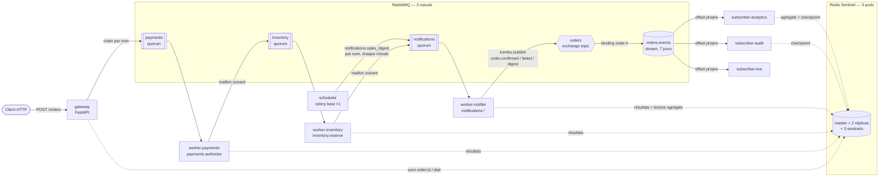

# OrderFlow

Projet de démonstration d'une architecture de traitement asynchrone sur Kubernetes,
volontairement simple mais construite comme en production :

- un **cluster RabbitMQ** de 3 nœuds (Cluster Operator) avec des **quorum queues** pour les tâches ;
- un **Redis Sentinel** à 3 pods (master + 2 réplicas, failover automatique) comme result backend ;
- des **workers Celery totalement indépendants**, qui ne s'appellent que par **nom de tâche**
  (aucun import entre services) ;
- un **RabbitMQ Stream** qui diffuse chaque événement métier à plusieurs abonnés, publié depuis
  un worker Celery avec kombu ;
- un **Celery beat** dédié (un seul réplica) qui déclenche des tâches planifiées, lui aussi
  uniquement par nom.

Cas d'usage : une commande e-commerce traverse paiement → stock → notification ; l'événement
final (`order.confirmed` ou `order.failed`) est lu par trois abonnés (analytics, audit, live),
chacun à son rythme et depuis son propre offset. Chaque minute, le beat demande au notifier un
**digest des ventes** (`order.digest`), publié dans le même stream.

## Architecture



## Les 6 idées clés

1. **Contrat par noms, pas par code.** Les services ne partagent que [`docs/contracts.md`](docs/contracts.md) :
   noms de tâches, de files, d'exchange, de stream et payloads JSON. Le gateway construit la chain
   avec `celery.signature("payments.authorize", …)` sans connaître le code des workers.
2. **Routage par préfixe.** `payments.authorize` va dans la file `payments`. Chaque worker publie
   lui-même le maillon suivant (ou l'errback) et déclare la file cible exactement comme son
   propriétaire (quorum + exchange topic), sinon RabbitMQ répond `PRECONDITION_FAILED`.
3. **Quorum queues + at-least-once.** Publisher confirms, `acks_late`, tâches idempotentes ;
   les retries utilisent la *native delayed delivery* de Celery (pas d'ETA gardée en mémoire).
4. **Stream pour la diffusion.** Un log non destructif lu par N abonnés, chacun avec son offset
   (`first`, `next`, entier), rejouable pendant 7 jours. Offsets sauvegardés côté client dans
   Redis ; `event_id` déterministe pour dédupliquer.
5. **Infra stateful maîtrisée.** RabbitMQ par l'opérateur officiel ; Redis Sentinel en StatefulSet
   écrit à la main (bootstrap, failover propre au `preStop`, noms DNS stables), PDB, probes
   fichier, conteneurs non-root en lecture seule.
6. **Planification par nom.** Un service `scheduler` exécute `celery beat` seul (aucune tâche,
   1 réplica, stratégie `Recreate`) et n'envoie que des noms de tâches ; `expires` empêche les
   ticks manqués de s'accumuler, un pod recréé ne rattrape rien.

## Prérequis

| Outil | Remarque |
|---|---|
| Kubernetes ≥ 1.29 | Rancher Desktop (k3s, moteur **dockerd/moby**) testé. Les volumes utilisent la StorageClass **par défaut** du cluster (`local-path` sur k3s) ; une autre classe se choisit par les values `rabbitmq.persistence.storageClassName` et `redis.persistence.storageClassName`. |
| cert-manager | **Obligatoire**, à installer avant : les webhooks d'admission du RabbitMQ Cluster Operator v2.23.2 utilisent un certificat émis par cert-manager (testé avec v1.21.3). |
| `helm` | v4 (testé avec v4.2.3) : les deux charts `charts/orderflow-infra` et `charts/orderflow`. |
| `kubectl` | avec le contexte du cluster cible (`rancher-desktop` ici). |
| `docker` | construit les 6 images `orderflow/*:dev`. |
| PowerShell | scripts `scripts/*.ps1` (Windows PowerShell 5.1 ou PowerShell 7). |
| `uv` (optionnel) | tests unitaires et développement local. |

Les images sont construites localement et référencées avec `imagePullPolicy: IfNotPresent` :
avec Rancher Desktop (dockerd), le k3s voit directement les images du démon docker. Sur tout
autre cluster, il faut pousser les images dans un registry et renseigner la value
`image.registry` (et `image.tag`) du chart `orderflow`.

## Démarrage rapide

```powershell
kubectl config use-context rancher-desktop   # cert-manager déjà installé (cf. Prérequis)

./scripts/deploy.ps1          # opérateur, release orderflow-infra, build des 6 images, release orderflow
helm test orderflow -n orderflow   # GET /readyz du gateway depuis le cluster
./scripts/demo.ps1            # 3 scénarios (valide, paiement refusé, rupture de stock) + dernier digest
./scripts/replay-demo.ps1     # un abonné tout neuf relit le stream depuis l'offset 0, puis reprise sur checkpoint
./scripts/chaos.ps1           # trafic pendant la perte du master Redis puis de rabbitmq-server-0 (code retour 1 si échec)
./scripts/destroy.ps1         # suppression après confirmation (-Force, -IncludeOperator pour l'opérateur)
```

`deploy.ps1` = `deploy-infra.ps1` (opérateur RabbitMQ par son manifeste épinglé, puis
`helm upgrade --install orderflow-infra`) puis `deploy-apps.ps1` (`build-images.ps1`, sauf
`-SkipBuild`, puis `helm upgrade --install orderflow`) ; chaque script est utilisable
séparément et relançable sans recréer de pod si rien n'a changé. Sans les scripts :

```powershell
kubectl apply --server-side -k k8s/operators/rabbitmq-cluster-operator
helm upgrade --install orderflow-infra charts/orderflow-infra -n orderflow --create-namespace --wait
kubectl -n orderflow wait --for=condition=AllReplicasReady rabbitmqcluster/rabbitmq --timeout=600s
helm upgrade --install orderflow charts/orderflow -n orderflow --wait
```

Deux releases parce que deux cycles de vie : l'infrastructure stateful change rarement et
prudemment, les applications à chaque build (cf. [ADR-16](docs/architecture.md#adr-16--déploiement-par-deux-charts-helm-opérateur-rabbitmq-à-part)).
Les scripts partagent leurs fonctions dans `scripts/lib/common.ps1`.
Détails, vérifications et dépannage : [docs/exploitation.md](docs/exploitation.md).

## Organisation du dépôt

```
docs/
  contracts.md          contrat inter-services (seul artefact partagé)
  architecture.md       composants, décisions de conception, limites
  cycle-de-vie.md       vie d'une commande, garanties de livraison, pannes
  exploitation.md       runbook : déploiement, vérifications, démo, chaos, dépannage
services/
  gateway/              API FastAPI, émet la chain Celery par noms
  worker-payments/      payments.authorize       (file payments)
  worker-inventory/     inventory.reserve        (file inventory)
  worker-notifier/      notifications.*          (file notifications) -> publie dans le stream
  subscriber/           consommateur kombu du stream (analytics / audit / live)
  scheduler/            celery beat seul : envoie notifications.sales_digest par nom (DIGEST_CRON)
charts/
  orderflow-infra/      release orderflow-infra : RabbitmqCluster + PDB, Redis Sentinel
                        (StatefulSet, scripts dans files/redis/, Services, PDB), Secret/redis-auth
  orderflow/            release orderflow : ConfigMap orderflow-config, gateway + Service,
                        workers, scheduler, subscribers, test helm (GET /readyz)
k8s/
  operators/            RabbitMQ Cluster Operator (manifeste de release épinglé, hors Helm)
scripts/                déploiement, démo, replay, chaos, destruction (PowerShell)
  lib/common.ps1        fonctions partagées (kubectl, helm, port-forward, HTTP, Redis, RabbitMQ)
dev/docker-compose.yml  environnement local sans Kubernetes
```

Chaque service est un projet `uv` autonome (son `pyproject.toml`, son `uv.lock`, son `Dockerfile`).

## Documentation

- [Contrat inter-services](docs/contracts.md)
- [Architecture et décisions](docs/architecture.md)
- [Cycle de vie d'une commande](docs/cycle-de-vie.md)
- [Exploitation (runbook)](docs/exploitation.md)

## Versions

Helm v4 (charts `apiVersion: v2`, version 0.1.0) · RabbitMQ Cluster Operator v2.23.2 · `rabbitmq:4.3.7-management` · `redis:8.10.3-alpine` ·
Python 3.13 · Celery 5.7.0 · kombu 5.7.0 · redis-py 8.1.0 · FastAPI 0.162.4 · uv 0.10.8.
