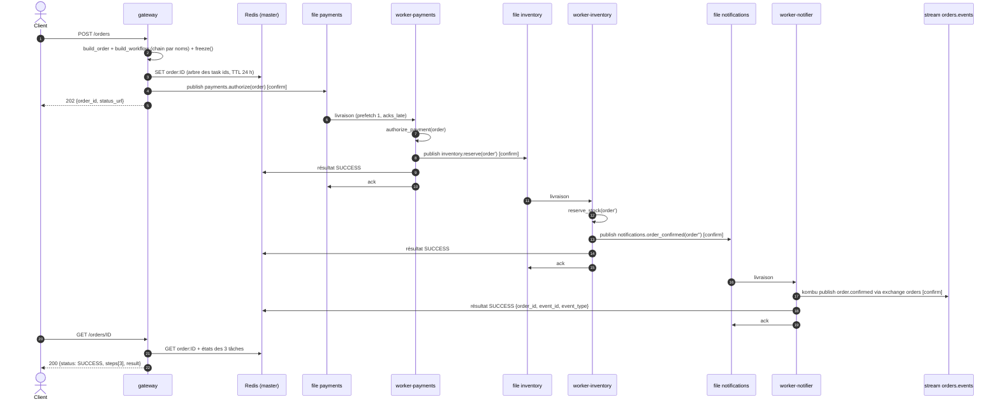
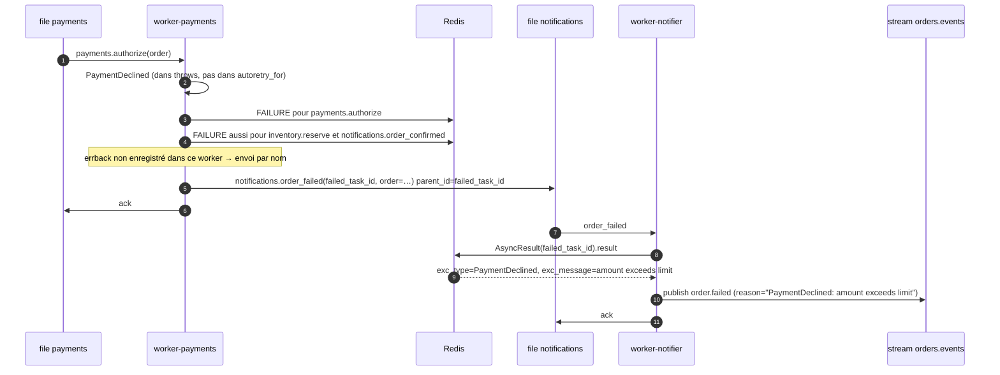
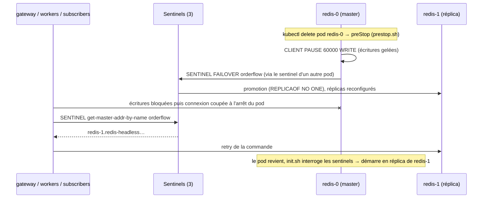
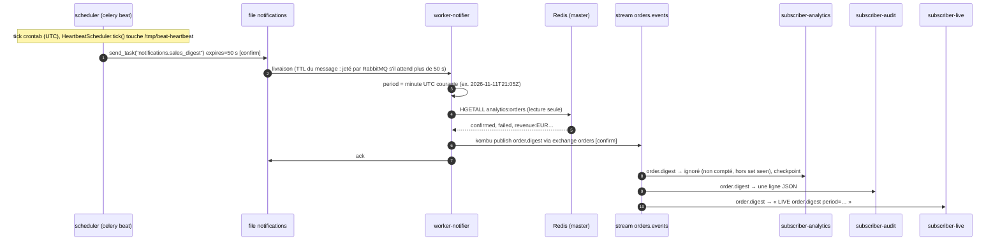

# Cycle de vie d'une commande

Ce document suit une commande de la requête HTTP jusqu'aux trois abonnés du stream, puis décrit
le chemin d'échec, les retries, les garanties de livraison à chaque saut, la consommation d'un
stream en AMQP 0.9.1, le comportement pendant les pannes d'infrastructure et enfin le cycle
planifié (digest des ventes envoyé par Celery beat, §8). Les extraits de code sont copiés des
sources du dépôt. Contexte : [architecture.md](architecture.md) ;
interfaces : [contracts.md](contracts.md).

## 1. Vue d'ensemble (chemin nominal)



Points à retenir :

- le gateway ne publie **que le premier maillon** ; chaque worker publie le suivant ;
- un worker publie le maillon suivant **avant** d'enregistrer son résultat et **avant** d'acquitter
  son message (ordre imposé par Celery, cf. §2.2) ;
- personne n'importe le code de personne : tout circule par noms de tâches et JSON.

## 2. Étape par étape

### 2.1 `POST /orders` : construire la chain par noms

Le corps est validé par Pydantic (`customer_id`, `currency` sur 3 lettres majuscules, 1 à 100
`items` avec `quantity` 1–1000 et `unit_price` > 0 à 2 décimales). `build_order` calcule le total
en `Decimal` puis produit le payload `Order` du contrat (montants convertis en `float` pour le
JSON) avec un `order_id` `ord_<uuid4 hex>`.

La chain est construite uniquement à partir de noms (`services/gateway/src/gateway/orders.py`) :

```python
# The chain emitted for every order, in execution order (contract section 3).
CHAIN_STEPS = ("payments.authorize", "inventory.reserve", "notifications.order_confirmed")
ERRBACK_TASK = "notifications.order_failed"
```

```python
def build_workflow(order: dict) -> Signature:
    """payments.authorize(order) | inventory.reserve | notifications.order_confirmed.

    The errback is attached to every link of the chain: whichever task fails, the failing
    worker sends ``notifications.order_failed(<failed task id>, order=order)`` by name.
    """
    workflow = chain(
        signature(CHAIN_STEPS[0], args=[order], app=celery_app),
        *(signature(name, app=celery_app) for name in CHAIN_STEPS[1:]),
    )
    workflow.link_error(signature(ERRBACK_TASK, kwargs={"order": order}, app=celery_app))
    return workflow
```

Seul le premier maillon reçoit `order` ; les suivants sont des signatures partielles qui
recevront en premier argument le résultat du maillon précédent (l'`Order` enrichi).

**Rendre la commande suivable, puis publier.** La clé de suivi est écrite **avant** la
publication :

```python
def submit_order(order: dict, redis: Redis, ttl_seconds: int) -> None:
    """Make the order trackable, then publish its chain.

    ``freeze()`` assigns the task ids of every link (and returns the result tree) without
    sending anything; ``apply_async()`` then publishes with exactly those ids. Storing the
    tracking key first guarantees that a published chain is always trackable: if Redis is
    down nothing is published, and if publishing fails the key is removed again (best
    effort). Either error propagates and becomes a 503.
    """
    workflow = build_workflow(order)
    key = order_key(order["order_id"])
    redis.set(key, json.dumps(workflow.freeze().as_tuple()), ex=ttl_seconds)
    try:
        workflow.apply_async()
    except Exception:
        try:
            redis.delete(key)
        except RedisError as exc:
            logger.warning("could not remove tracking key %s after a failed publish: %s", key, exc)
        raise
```

Pourquoi cet ordre : le test de chaos a montré qu'avec l'ordre inverse (publier puis écrire la
clé), une bascule Redis au mauvais moment produisait une `500` pour une commande dont la chain
était déjà partie — commande traitée mais introuvable par `GET`. Avec `freeze()`, les ids de
toutes les tâches sont connus avant l'envoi ; si Redis est indisponible, rien n'est publié.
Résidu assumé : si la publication échoue de façon ambiguë (message reçu par le broker mais
confirmation perdue), la clé est supprimée alors que la chain peut s'exécuter ; le client reçoit
une `503` et, s'il réessaie, crée une seconde commande (nouvel `order_id`).

**Routage.** Celery appelle la fonction de routage, identique dans les cinq applications Celery
(`services/*/src/*/celery_app.py`) :

```python
def route_by_prefix(name: str, args, kwargs, options, task=None, **kw) -> dict | None:
    """Route ``<queue>.<action>`` to the queue named by the prefix (contract section 3)."""
    queue, sep, _ = name.partition(".")
    if not sep or queue == "celery":
        return None  # Celery built-in tasks keep the default routing.
    return {"queue": queue}
```

La file `payments` n'est pas configurée dans le gateway : Celery la crée à la volée
(`task_create_missing_queue_type="quorum"`, exchange `topic` homonyme), à l'identique du worker.

**Publication confirmée.** `broker_transport_options={"confirm_publish": True}` : `apply_async`
ne rend la main qu'après l'accusé du broker, donc après écriture sur une majorité des membres de
la quorum queue. Côté gateway, `task_publish_retry_policy` réessaie pendant ~6 s (reconnexion
via le Service `rabbitmq` si le nœud derrière la connexion a disparu).

**Réponses.** `202 {order_id, status_url}`. Si Redis ou le broker restent injoignables malgré les
retries : `503` avec `Retry-After: 5` (gestionnaires d'exception de `main.py` pour
`redis.ConnectionError`, `redis.TimeoutError`, `ReadOnlyError` et `kombu.exceptions.OperationalError`).

### 2.2 `payments.authorize`

Le worker consomme `payments` avec `worker_prefetch_multiplier=1` et `task_acks_late=True` : il
ne réserve qu'un message par processus et ne l'acquitte qu'après exécution.

```python
@app.task(
    name="payments.authorize",
    autoretry_for=INFRA_ERRORS,
    retry_backoff=True,
    retry_backoff_max=60,
    retry_jitter=True,
    max_retries=5,
    throws=(PaymentDeclined,),  # expected failure: logged without traceback
)
def authorize(order: dict) -> dict:
```

La règle simulée refuse au-delà de 1000 (`PaymentDeclined("amount exceeds limit")`) ; sinon le
retour est l'`Order` enrichi de `payment`, avec un `authorization_id` dérivé de `order_id`
(`auth_` + sha256 tronqué) : rejouer la tâche produit la même autorisation.

**Ce que fait Celery après le retour de la tâche**, dans cet ordre (`celery/app/trace.py`) :

1. publier le maillon suivant (`inventory.reserve`) avec le retour comme premier argument, l'id
   figé par le gateway, et le reste de la chain dans le message ;
2. enregistrer le résultat `SUCCESS` dans Redis (`mark_as_done`) ;
3. acquitter le message `payments` (`acks_late`).

Pour publier dans `inventory`, worker-payments déclare cette file — qu'il ne consomme pas —
avec ses propres réglages. Ils doivent être identiques à ceux de worker-inventory, sinon
`PRECONDITION_FAILED` ([architecture.md, ADR-04](architecture.md#adr-04--task_create_missing_queue_typequorum-partout)).

### 2.3 `inventory.reserve`

Même mécanique. Refus si un item a le SKU `OUT-OF-STOCK`
(`OutOfStock("sku OUT-OF-STOCK unavailable")`) ; sinon ajout de `reservation` avec un
`reservation_id` dérivé de `order_id`. worker-inventory publie ensuite
`notifications.order_confirmed` dans `notifications`.

### 2.4 `notifications.order_confirmed` : publier dans le stream depuis la tâche

La tâche construit l'événement et le publie sur le **pool de connexions broker du worker
Celery** (`services/worker-notifier/src/notifier/tasks.py`) :

```python
def emit(order: dict, event_type: str, reason: str | None = None) -> dict:
    event = build_event(order, event_type, datetime.now(UTC), reason)
    with app.producer_or_acquire() as producer:
        publish_event(producer, event)
    logger.info("event published order_id=%s event_type=%s event_id=%s reason=%s",
                order["order_id"], event_type, event["event_id"], reason)
    return {"order_id": order["order_id"], "event_id": event["event_id"], "event_type": event_type}
```

La publication kombu (`services/worker-notifier/src/notifier/events.py`) :

```python
ORDERS_EXCHANGE = Exchange("orders", type="topic", durable=True)
# Declared idempotently on every publish: same arguments as the subscribers' declaration.
EVENTS_STREAM = Queue(
    "orders.events",
    exchange=ORDERS_EXCHANGE,
    routing_key="order.#",
    durable=True,
    queue_arguments={"x-queue-type": "stream", "x-max-age": "7D"},
)
```

```python
def publish_event(producer: Producer, event: dict) -> None:
    """Publish with publisher confirms (the broker connection has ``confirm_publish``).

    ``publish`` returns once the broker confirmed the message; a nack or an exhausted
    retry raises, which fails the Celery task so it can be retried.
    """
    producer.publish(
        event,
        exchange=ORDERS_EXCHANGE,
        routing_key=event["event_type"],
        serializer="json",
        delivery_mode=2,
        message_id=event["event_id"],
        declare=[ORDERS_EXCHANGE, EVENTS_STREAM],
        retry=True,
        retry_policy=PUBLISH_RETRY_POLICY,
    )
```

- `declare=[…]` : l'exchange, le stream et le binding `order.#` sont (re)déclarés de façon
  idempotente ; le premier qui publie ou s'abonne les crée.
- La routing key est le type d'événement (`order.confirmed`, `order.failed`), capturée par le
  binding `order.#`.
- `event_id` = `evt_` + sha256(`order_id:event_type`)[:24] : un événement republié après un rejeu
  de la tâche porte le même id (et le même `message_id`).
- Échec de publication : kombu réessaie 3 fois (reconnexion + redéclaration), puis l'exception
  (`OperationalError`, `MessageNacked`) remonte et l'`autoretry_for` de la tâche prend le relais
  (backoff jusqu'à 60 s, 10 tentatives).

Le retour de la tâche (`{order_id, event_id, event_type}`) devient le `result` final de la chain.

### 2.5 Trois abonnés, trois offsets

Le stream est un log : le message à l'offset *n* est livré à **chaque** consommateur attaché,
indépendamment. Les trois subscribers sont des processus kombu
(`services/subscriber/src/subscriber/consumer.py`) :

```python
    def get_consumers(self, Consumer, channel):
        start = resolve_start_offset(self.offset_spec, self.last_offset)
        logger.info("attaching to stream %s at offset=%s (last processed=%s)", STREAM, start, self.last_offset)
        queue = Queue(
            STREAM,
            exchange=ORDERS_EXCHANGE,
            routing_key="order.#",
            durable=True,
            queue_arguments=STREAM_ARGUMENTS,
            consumer_arguments={"x-stream-offset": start},
        )
        # kombu applies prefetch_count with basic.qos(global=False) before basic.consume.
        return [Consumer(queues=[queue], callbacks=[self.on_message], accept=["json"],
                         prefetch_count=self.prefetch_count, no_ack=False)]
```

| Subscriber | Offset initial | Checkpoint | Traitement |
|---|---|---|---|
| `analytics` | `first` | oui | script Lua : dédup `event_id` + compteurs `confirmed`/`failed`/`revenue:<CUR>` |
| `audit` | `first` | oui | une ligne JSON brute par événement sur stdout, avec `stream_offset` |
| `live` | `next` | non | une ligne `LIVE …` par événement, temps réel seulement |

Exemple réel (même événement, offset 62, vu par les trois) :

```text
[analytics] analytics offset=62 order_id=ord_7062… event_type=order.confirmed counted confirmed=61 failed=2 revenue={EUR: 639.80}
{"currency": "EUR", "customer_id": "chaos_60", "event_id": "evt_6376a5d7d04d21fa1605c0ee", "event_type": "order.confirmed", ..., "stream_offset": 62, "total_amount": 10.0}
[live] LIVE order.confirmed order_id=ord_7062… customer_id=chaos_60 amount=10.0 EUR
```

### 2.6 `GET /orders/{order_id}` : reconstruire l'état

La clé `order:<id>` contient l'arbre `as_tuple()` du **dernier** maillon (avec ses parents). Le
gateway remonte la chaîne des parents et lit l'état de chaque tâche dans le result backend :

```python
def load_status(order_id: str, redis: Redis) -> OrderStatus | None:
    raw = redis.get(order_key(order_id))
    if raw is None:
        return None
    last = result_from_tuple(json.loads(raw), app=celery_app)
    results: list[AsyncResult] = []
    node: AsyncResult | None = last
    while node is not None:
        results.append(node)
        node = node.parent
    results.reverse()
    steps = [Step(task=name, task_id=r.id, state=r.state) for name, r in zip(CHAIN_STEPS, results, strict=True)]
    return summarize(order_id, steps, results)
```

Règles de `summarize` : premier maillon en `FAILURE` → `status=FAILURE` et `error` tiré de ce
maillon ; dernier maillon en `SUCCESS` → `SUCCESS` et `result` ; tout `PENDING` → `PENDING` ;
sinon `PROCESSING` (`STARTED`, `RETRY`, maillons partiellement terminés). Une tâche jamais vue par
un worker apparaît `PENDING` (Celery ne distingue pas « en file » et « inconnue ») ; `404` si la
clé de suivi n'existe pas (ou a expiré après `ORDER_TTL_SECONDS`).

Exemple de réponse pour une commande valide :

```json
{
  "order_id": "ord_…",
  "status": "SUCCESS",
  "steps": [
    {"task": "payments.authorize", "task_id": "…", "state": "SUCCESS"},
    {"task": "inventory.reserve", "task_id": "…", "state": "SUCCESS"},
    {"task": "notifications.order_confirmed", "task_id": "…", "state": "SUCCESS"}
  ],
  "result": {"order_id": "ord_…", "event_id": "evt_…", "event_type": "order.confirmed"},
  "error": null
}
```

## 3. Chemin d'échec

Exemple : total > 1000, `payments.authorize` lève `PaymentDeclined`.



Détails (vérifiés dans `celery/backends/base.py`, `mark_as_failure`) :

1. Celery enregistre l'échec de la tâche, **puis** marque `FAILURE` les maillons restants de la
   chain (`_fail_chain`), **puis** appelle les errbacks de la tâche en échec. La cause est donc
   dans Redis avant que l'errback ne parte.
2. L'errback est attaché à chaque maillon, mais seul le maillon qui échoue l'exécute : les
   suivants ne tournent jamais. Un seul `order.failed` par commande.
3. `notifications.order_failed` n'est pas enregistrée dans worker-payments : Celery l'envoie par
   nom avec l'id de la tâche en échec comme **unique argument positionnel** (et `parent_id` = cet
   id) ; les kwargs de la signature (`order`) sont conservés. D'où la signature du contrat :

   ```python
   @app.task(name="notifications.order_failed", **RETRY_OPTIONS)
   def order_failed(failed_task_id: str, *, order: dict) -> dict:
       ...
       failed = app.AsyncResult(failed_task_id)
       reason = describe_failure(failed.result, failed.state)
       return emit(order, ORDER_FAILED, reason)
   ```

4. La classe `PaymentDeclined` n'existe pas dans worker-notifier : Celery reconstruit une
   exception du même nom depuis le JSON du résultat, et `describe_failure` produit
   `"PaymentDeclined: amount exceeds limit"`.
5. Le `GET` renvoie `status: FAILURE`, les trois `steps` en `FAILURE`, et `error` tiré du premier.

Même schéma pour `OUT-OF-STOCK` : `payments` en `SUCCESS`, `inventory` et `notifications` en
`FAILURE`, `error = "OutOfStock: sku OUT-OF-STOCK unavailable"`.

## 4. Chemin de retry

Les erreurs d'infrastructure (`ConnectionError`, `TimeoutError` ; pour le notifier aussi
`OperationalError`, `MessageNacked` et les erreurs Redis) déclenchent `autoretry_for` avec backoff
exponentiel plafonné à 60 s et jitter (5 tentatives pour payments/inventory, 10 pour le notifier).
Les erreurs métier (`throws`) ne sont jamais réessayées.

Un retry republie la tâche avec un compte à rebours. Sur quorum queues, Celery utilise la
*native delayed delivery* au lieu de garder un message à ETA non acquitté dans le worker :

```mermaid
flowchart LR
    W["worker : retry, countdown = 5 s<br/>routing key 0.0.….1.0.1.payments"] --> X27{{"exchange celery_delayed_27"}}
    X27 -->|"bit 27 = 1"| Q27[["file celery_delayed_27<br/>TTL 2^27 s"]]
    X27 -->|"bit 27 = 0"| X26{{"exchange celery_delayed_26"}}
    Q27 -.->|"dead-letter"| X26
    X26 -->|"… niveaux 25 à 1 …"| X0{{"exchange celery_delayed_0"}}
    X0 -->|"bit 0 = 1"| Q0[["file celery_delayed_0<br/>TTL 1 s"]]
    X0 -->|"bit 0 = 0"| DD{{"celery_delayed_delivery"}}
    Q0 -.->|"dead-letter"| DD
    DD -->|"binding #.payments"| QP[["payments"]]
```



Le délai (en secondes entières) est encodé en binaire sur 28 bits dans la routing key, suivi de
la routing key d'origine. Celery publie sur l'exchange `celery_delayed_27` ; à chaque niveau *N*,
si le bit *N* vaut 1 le message attend 2^N secondes dans la file `celery_delayed_N` (TTL) puis est
dead-lettré vers le niveau inférieur, sinon il y passe directement (binding exchange → exchange).
Il arrive enfin sur `celery_delayed_delivery`, qui le route vers la file d'origine par le binding
`#.payments`. Ce binding à joker exige un exchange `topic`
([ADR-03](architecture.md#adr-03--chaque-file-est-liée-à-un-exchange-topic-du-même-nom)).
Pendant l'attente, le message est dans RabbitMQ (files quorum répliquées), aucun slot de worker
n'est occupé, et un redémarrage du worker ne le perd pas.

Si les retries sont épuisés, la tâche passe en `FAILURE` et le chemin d'échec (§3) s'applique.

## 5. Garanties de livraison, saut par saut

| Saut | Mécanisme | Garantie | Doublon possible ? | Protection |
|---|---|---|---|---|
| Client → gateway | HTTP | aucune en cas de coupure réseau | oui, si le client réessaie après un timeout | `order_id` généré côté serveur : un retry client crée une nouvelle commande (pas de clé d'idempotence client — cf. limites) |
| gateway → `payments` | publisher confirm, quorum queue | message écrit sur la majorité avant le `202` | rare (publication ambiguë) | — |
| file → worker | `acks_late`, `task_reject_on_worker_lost`, prefetch 1 | *at-least-once* | oui : crash après exécution, avant ack | tâches idempotentes (ids dérivés de `order_id`) |
| worker → maillon suivant | publié **avant** l'ack, avec confirm | le maillon suivant existe dès que le précédent est acquitté | oui : rejeu du maillon précédent → maillon suivant republié **avec le même task id** | idempotence du maillon suivant |
| worker → result backend | écriture Redis avant l'ack | résultat présent dès l'ack (hors perte asynchrone lors d'un failover non planifié) | réécriture du même résultat | — |
| notifier → stream | kombu `publish` avec confirm, dans la tâche | *at-least-once* | oui : rejeu de la tâche après publish | `event_id` déterministe |
| stream → subscriber | prefetch + ack manuel, checkpoint après traitement | *at-least-once* | oui : crash entre traitement et checkpoint, ou réattache en milieu de chunk | skip des offsets ≤ checkpoint ; `analytics` déduplique sur `event_id` (Lua atomique) |
| scheduler → `notifications` | publisher confirm, `expires` 50 s (TTL du message + contrôle worker) | *at-most-once par tick* : un tick non exécuté dans les 50 s est abandonné | oui : tick relivré après crash du notifier | même `period` donc même `event_id` (§8) |

En résumé : **at-least-once de bout en bout**, rendu *effectively-once* là où ça compte
(agrégats d'`analytics`) par l'idempotence et la déduplication.

## 6. Consommer un stream en AMQP 0.9.1

Un stream se consomme avec un client AMQP 0.9.1 ordinaire, à quelques règles près :

| Règle | Pourquoi | Dans le code |
|---|---|---|
| **Prefetch obligatoire** (`basic.qos`, `global=False`) | RabbitMQ refuse un consommateur de stream sans prefetch ; il borne le nombre de messages en vol. | `prefetch_count=self.prefetch_count` (`PREFETCH_COUNT`, défaut 50) |
| **Ack manuel** (`no_ack=False`) | L'ack ne supprime rien : il **rend du crédit** au consommateur. Sans ack, la livraison s'arrête après `prefetch_count` messages. | `message.ack()` |
| **`x-stream-offset`** | Choix du point d'attache : `first` (début de la rétention), `last` (dernier chunk), `next` (seulement les nouveaux), un entier (offset absolu) ; un timestamp est aussi possible (non utilisé). | `consumer_arguments={"x-stream-offset": start}` |
| **En-tête `x-stream-offset`** | Chaque message livré porte son offset absolu. | `offset = message.headers["x-stream-offset"]` |
| **Déclaration identique** | Le subscriber redéclare le stream : mêmes arguments que l'éditeur, sinon `PRECONDITION_FAILED`. | `STREAM_ARGUMENTS = {"x-queue-type": "stream", "x-max-age": "7D"}` |

**Checkpoint et reprise.** Le traitement d'un message :

```python
    def on_message(self, body: dict, message: Message) -> None:
        offset = message.headers["x-stream-offset"]
        # Delivery starts at the beginning of the chunk holding the requested offset, so
        # messages already processed may come again after a re-attach: skip them.
        if self.last_offset is not None and offset <= self.last_offset:
            logger.debug("skipping already processed offset=%s", offset)
            message.ack()
            return
        self.handler(body, offset)
        if self.checkpoint:
            self.checkpoint.save(offset)
        message.ack()
        self.last_offset = offset
```

- Au démarrage, `last_offset` est chargé depuis `stream:orders.events:offset:<SUBSCRIBER_NAME>` ;
  s'il existe, l'attache se fait à `last_offset + 1`, sinon à `STREAM_OFFSET`.
- `last_offset` est aussi gardé en mémoire : après une coupure broker, `ConsumerMixin` se
  reconnecte et `get_consumers` se réattache juste après le dernier message traité — y compris
  pour `live`, qui n'a pas de checkpoint (il ne revient à `next` qu'après un redémarrage du
  processus).
- RabbitMQ livre à partir du début du *chunk* contenant l'offset demandé : quelques messages
  déjà traités peuvent revenir, d'où le test `offset <= self.last_offset`.

**Replay par un abonné tout neuf.** Un subscriber avec un nouveau `SUBSCRIBER_NAME` n'a pas de
checkpoint : avec `STREAM_OFFSET=first`, il relit tout l'historique encore retenu (7 jours), sans
rien changer pour les autres abonnés. `SUBSCRIBER_ROLE` permet de lui donner le comportement
d'un abonné existant (par ex. `SUBSCRIBER_NAME=audit-replay`, `SUBSCRIBER_ROLE=audit`). C'est ce
que fait `scripts/replay-demo.ps1` ([exploitation.md](exploitation.md#démo-de-replay)).

## 7. Pendant les pannes

### 7.1 Bascule Redis (perte du master)



Mesuré sur ce cluster (`kubectl delete pod` du master, donc arrêt gracieux avec `preStop`) :
nouveau master en ~2 s, ancien pod revenu en réplica en ~19 s. Rolling restart complet du
StatefulSet : ~83 s, sans perte d'écriture acquittée. En cas de crash (pas de `preStop`), les
sentinels doivent d'abord constater la panne (`down-after-milliseconds 5000`, quorum 2) avant
d'élire un réplica : la fenêtre d'indisponibilité est plus longue (non mesurée ici), et c'est le
cas où `init.sh` attend jusqu'à 20 s le failover avant de redémarrer l'ancien master en réplica.

Les clients interrogent Sentinel via le Service `redis-sentinel` (`REDIS_SENTINELS`), qui ne
route que vers les pods prêts : le pod supprimé sort des endpoints dès le début de son arrêt.
Avec l'ancienne liste `redis-0..2.redis-headless`, la perte de `redis-0` (premier de la liste)
ajoutait ~5 s de résolution DNS du pod disparu à chaque redécouverte du master : POST le plus
lent 7,2 s, contre 2,2 s avec le Service (mesures `chaos.ps1`, master = `redis-0`).

Comportement des clients pendant la fenêtre :

| Client | Comportement |
|---|---|
| gateway | `Retry` redis-py (8 tentatives, backoff 0,1 s → 1 s, sur `ConnectionError`, `TimeoutError`, `ReadOnlyError`) ; chaque retry redemande le master à Sentinel. Au-delà : `503` + `Retry-After`. Le result backend du gateway utilise la même politique et ne s'abonne pas aux canaux pub/sub de résultat (`GatewayResultBackend.on_task_call` neutralisé). |
| workers | Le result backend Celery (Sentinel) se reconnecte ; une erreur Redis pendant une tâche du notifier déclenche son `autoretry`. Les messages non acquittés restent dans RabbitMQ. |
| subscribers | Le client Sentinel de redis-py redécouvre le master à la reconnexion ; une erreur qui remonterait jusqu'au processus le ferait redémarrer par Kubernetes, et il reprendrait à son checkpoint. Ce cas ne s'est pas produit pendant les tests de chaos. |

Risque résiduel : lors d'un failover **non planifié** (crash, pas de `preStop`), les écritures
acquittées par l'ancien master mais pas encore répliquées sont perdues (réplication asynchrone).

### 7.2 Perte d'un nœud RabbitMQ

- Les quorum queues et le stream ont 3 membres : la perte d'un nœud laisse une majorité, un
  nouveau leader est élu si besoin, aucune donnée confirmée n'est perdue.
- Les clients connectés à ce nœud perdent leur connexion et se reconnectent via le Service
  `rabbitmq` sur un nœud survivant : workers Celery (reconnexion du consumer ; les messages
  non acquittés du nœud perdu sont relivrés → rejeu idempotent), gateway (retry de publication
  ~6 s puis `503`), notifier (retry kombu puis `autoretry`), subscribers (`ConsumerMixin`, réattache
  à `last_offset + 1`).
- Mesuré : retour à 3 nœuds en ~54 s après suppression d'un pod `rabbitmq-server-N`.
- Test de chaos avec trafic (60 commandes à 2/s, suppression du master Redis puis de
  `rabbitmq-server-0`). Première campagne : 59 commandes acceptées sur 60, la requête restante
  ayant révélé le défaut décrit au §2.1. Depuis la correction du gateway, toutes les commandes
  sont acceptées et terminent en `SUCCESS`, sans redémarrage de pod applicatif, scheduler
  compris (résultats détaillés : [exploitation.md](exploitation.md#test-de-chaos)).

## 8. Cycle planifié : le digest des ventes

Chaque minute (`DIGEST_CRON`), le **scheduler** (Celery beat) envoie par nom la tâche
`notifications.sales_digest`. Le notifier lit les agrégats tenus par `subscriber-analytics`
et publie un événement `order.digest` dans le même stream que les commandes.



### 8.1 Le beat ne connaît que des noms

Le planning est construit à partir de l'environnement (`services/scheduler/src/scheduler/celery_app.py`) :

```python
def build_beat_schedule(config: Settings) -> dict:
    """Beat entries, by task name only.

    ``expires``: Celery sets it both as the AMQP per-message TTL (``expiration``: RabbitMQ
    drops a tick nobody consumed in time) and in the task headers (the worker discards a
    tick received, or redelivered, too late). The ticks missed while the notifier is down
    never pile up and run late in a burst; the next tick produces a fresh digest anyway.
    """
    if not 1 <= config.digest_expires_seconds <= MAX_EXPIRES_SECONDS:
        raise ValueError(
            f"DIGEST_EXPIRES_SECONDS={config.digest_expires_seconds}: expected 1..{MAX_EXPIRES_SECONDS}"
        )
    return {
        "sales-digest": {
            "task": DIGEST_TASK,
            "schedule": crontab.from_string(config.digest_cron),  # "m h dom mon dow", UTC
            "options": {"expires": config.digest_expires_seconds},
        },
    }
```

La tâche n'est pas enregistrée dans le scheduler : beat la publie avec `send_task`, routée par
préfixe vers `notifications`, déclarée quorum + exchange topic comme partout. La liveness repose
sur la boucle de beat elle-même (`services/scheduler/src/scheduler/probes.py`) :

```python
class HeartbeatScheduler(PersistentScheduler):
    """``PersistentScheduler`` (shelve file) that touches ``HEARTBEAT_FILE`` on every tick."""

    def tick(self, *args, **kwargs):
        HEARTBEAT_FILE.touch()
        return super().tick(*args, **kwargs)
```

### 8.2 Identifier le tick, publier le digest

`services/worker-notifier/src/notifier/tasks.py` (docstring omise) :

```python
@app.task(name="notifications.sales_digest", bind=True, ignore_result=True, max_retries=DIGEST_MAX_RETRIES)
def sales_digest(self, period: str | None = None) -> dict:
    period = parse_period(period) if period else digest_period(datetime.now(UTC))
    try:
        totals = analytics_redis().hgetall(ANALYTICS_KEY)
        event = build_digest_event(period, totals, datetime.now(UTC))
        with app.producer_or_acquire() as producer:
            publish_event(producer, event)
    except INFRA_ERRORS as exc:
        # The retry carries the period computed by the first attempt (same event_id).
        raise self.retry(args=(period,), exc=exc, countdown=DIGEST_RETRY_COUNTDOWN_SECONDS) from exc
    logger.info("digest published period=%s event_id=%s confirmed=%s failed=%s revenue=%s",
                period, event["event_id"], event["confirmed"], event["failed"], event["revenue"])
    return {"period": period, "event_id": event["event_id"], "event_type": event["event_type"]}
```

- **Quelle minute ?** Les arguments d'une entrée beat sont statiques : beat ne peut pas passer
  l'heure de son tick. Le worker prend la minute courante. Comme `expires` < 60 s et que beat
  envoie en début de minute (`Sending due task` à hh:mm:00,0xx dans les logs), toute exécution
  — y compris une relivraison — a lieu dans la même minute : même `period`, même `event_id`
  (`evt_` + sha256(`period:order.digest`)[:24]). Compromis : un beat en retard d'une minute
  entière étiquetterait le digest avec la minute d'envoi, sans gravité pour un instantané.
- **Retry** (Redis ou broker indisponible) : 3 au plus, 5 s d'écart, avec la `period` de la
  première tentative ; `expires` reste attaché au message réessayé.
- **Lecture Redis** : client Sentinel durci recopié du gateway (`notifier/redis_client.py`),
  créé au premier usage dans chaque processus du pool prefork.

### 8.3 Côté abonnés

| Subscriber | `order.digest` | Type inconnu |
|---|---|---|
| `analytics` | ignoré **avant** le script Lua : rien n'est compté, rien n'entre dans `analytics:orders:seen` ; le checkpoint avance | idem (DEBUG) |
| `audit` | une ligne JSON comme tout événement | une ligne JSON (un journal d'audit ne filtre pas) |
| `live` | `LIVE order.digest period=2026-11-11T22:59Z confirmed=564 failed=8 revenue={EUR: 7050.00}` | DEBUG, acquitté |

Exemple réel (offset 583 du stream, vu par audit) :

```text
{"confirmed": 564, "event_id": "evt_395575eab65e0b1a19b70a0f", "event_type": "order.digest", "failed": 8, "occurred_at": "2026-11-11T22:59:00Z", "period": "2026-11-11T22:59Z", "revenue": {"EUR": 7050.0}, "stream_offset": 583}
```

### 8.4 Pannes et redémarrages

| Situation | Comportement (mesuré sur ce cluster) |
|---|---|
| Pod scheduler supprimé (rollout, nœud) | `Recreate` : l'ancien pod est arrêté avant la création du nouveau. Nouveau pod = `/tmp` vide, premier envoi au créneau suivant, aucun rattrapage (pod supprimé à 22:59:16, envoi suivant à 23:00:00). |
| Conteneur beat redémarré dans le même pod | Le fichier de planning est conservé ; `beat_cron_starting_deadline=30` empêche de rejouer un créneau vieux de plus de 30 s (conteneur tué à 23:02:38, envoi suivant à 23:03:00, pas de doublon). |
| worker-notifier arrêté | Les ticks expirent dans la file (TTL 50 s) : à la reprise, aucun digest ancien n'est exécuté (notifier arrêté de 23:04:42 à 23:07:03 : ticks de 23:05 et 23:06 envoyés puis abandonnés, file vide, seul celui de 23:07 exécuté). |
| Bascule Redis pendant un tick | Retries du client Sentinel, puis `self.retry` de la tâche (même `period`). |
| Beat arrêté durablement | Pas de digest ; rien ne s'accumule ; reprise au créneau suivant après redémarrage. |
